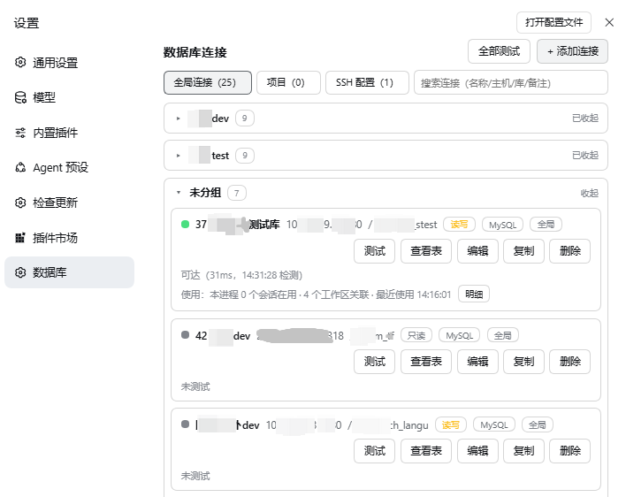
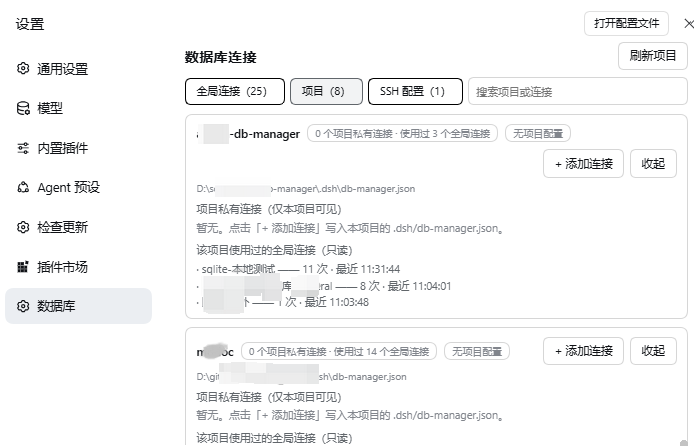
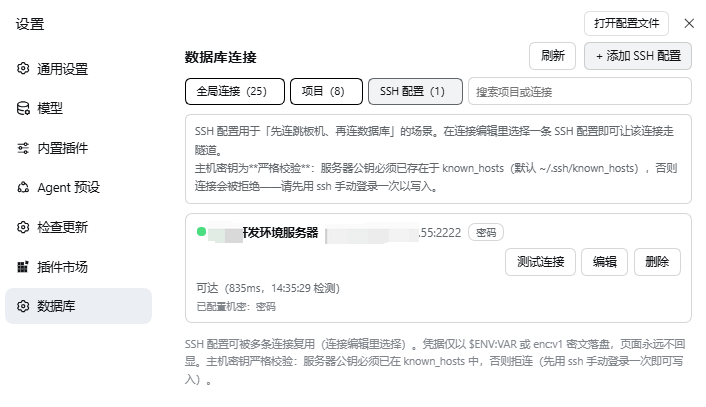
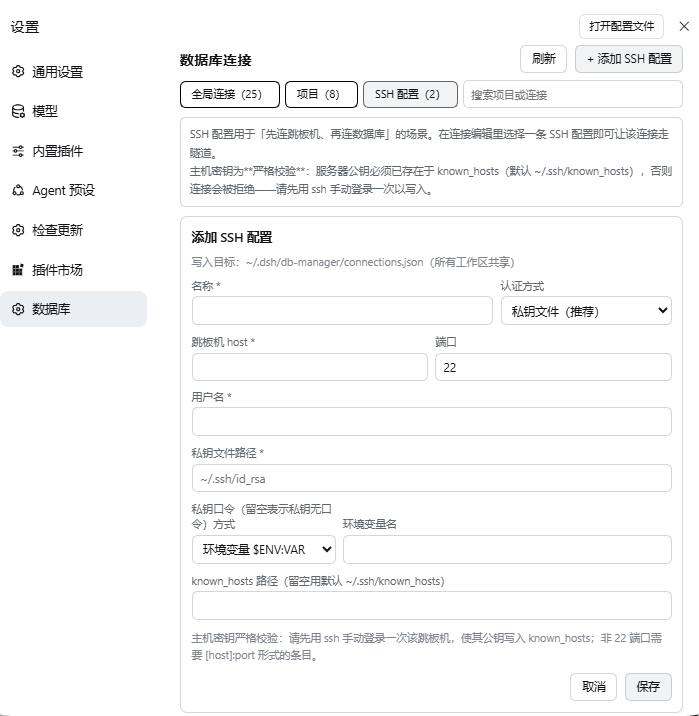
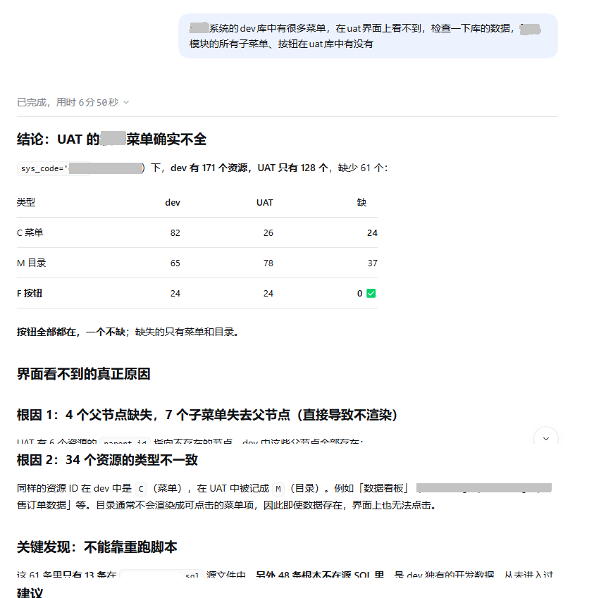
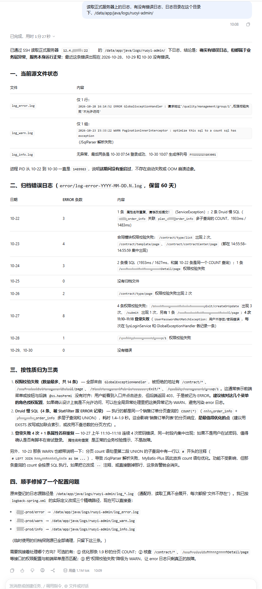

# dsh-db-manager

在 DSH 对话里直接**查数据库**和**读服务器日志**的插件——不用切窗口，不用手工贴 SQL 和日志，模型自己去连、去看、去分析。

> **定位：独立简易版。** 一个插件、几个本地 JSON 配置文件，装上就能用。
> 不接任何云服务或代理、不需要中间件、不带服务端；MySQL / PostgreSQL 走纯 JS 驱动，SQLite 用 Node 22 内置的 `node:sqlite`——**没有 native binding，没有编译工具链**。

## 功能

| 能力 | 说明 |
|---|---|
| **连接管理** | 设置页「数据库」分区统一管理：全局连接（所有工作区共享）+ 项目私有连接（写进项目自己的 `.dsh/db-manager.json`）+ 可复用的 SSH 配置；支持搜索、分组折叠、复制、连通性测试、只读查看表结构与 DDL |
| **查数据** | `db_query` 只读查询（自动补 LIMIT），配合 `db_list_databases` / `db_list_tables` / `db_describe_table` 先摸清结构再提问 |
| **写数据（受控）** | `db_execute` 执行单条写/DDL：先按策略把受影响行影子备份到同库备份表，高危语句走人工审批或 HMAC 确认令牌 |
| **一句话加库** | `db_add_connection` 一次调用完成「校验 → 写配置 → 连通性测试」，明文密码由 Host 即时加密落盘 |
| **SSH 隧道** | 数据库只允许从跳板机访问时，给连接指定一条 SSH 配置即可：agent / 私钥文件 / 内联 PEM / 密码四种认证，**主机密钥严格校验**，转发只绑 `127.0.0.1` |
| **读服务器日志**（v0.22 新增） | 给 SSH 配置登记一份**日志源白名单**（普通日志文件或 systemd 单元），AI 就能 `db_read_ssh_log` 读尾部、`db_search_ssh_logs` 用一个 traceId / 错误码跨多个源检索、`db_add_ssh_log_source` 在对话里当场补一条源。**只读且无 shell**：文件走 SFTP 定长 tail，systemd 走固定模板 `journalctl`，路径与命令只存在于配置里，模型只能给名称；单次额度一个配置项（`logMaxBytes`，默认 100 KB），超出保留最新行并标记截断；支持经跳板机再跳到第二台机器（`via`） |
| **三种方言** | MySQL / PostgreSQL / SQLite，工具签名与返回结构完全一致 |
| **审计** | 工具调用与 GUI 变更写本地按天滚动的 JSONL（凭据打码，日志正文与关键字不入库） |

## 工具清单（13 个）

| 类别 | 工具 |
|---|---|
| 连接 | `db_list_connections` `db_add_connection` `db_test_connection` `db_reload_config` |
| 结构 | `db_list_databases` `db_list_tables` `db_describe_table` |
| 查询与写入 | `db_query`（只读） `db_execute`（受控写） |
| 服务器日志 | `db_list_ssh_logs` `db_read_ssh_log` `db_search_ssh_logs` `db_add_ssh_log_source` |

## 界面

> 开发环境实拍，连接名、主机地址与账号均已打码。

| 全局连接：分组折叠、状态徽章、使用关联 | 项目视角：项目私有连接 + 该项目用过的全局连接（只读） |
|---|---|
|  |  |
| **SSH 配置**：一条跳板机配置可被多条连接复用，认证方式与可达状态一目了然 | **新增 SSH 配置**：四种认证任选，私钥口令可留空，底部一行一条登记日志源 |
|  |  |

## 对话示例

**查数据库**：问「dev 库有、uat 界面看不到的菜单差在哪」，模型自己比两个库的资源表，直接给出差异表与根因。



**读服务器日志**：问「正式服务器日志里有没有错误」，模型经 SSH 读日志尾部，按性质归类（权限校验失败 / 慢 SQL / 登录失败）并给出处置建议。



## 安装

前置：Node ≥ 22.3、DSH ≥ `0.2.1-alpha.2`。

```bash
# 已发布 npm 包时（市场一键安装等价于此）
dsh plugin --profile web add dsh-db-manager

# 源码方式
git clone <repo> && cd dsh-db-manager
npm install && npm run build          # DSH 沙箱内改用 node scripts/build-sandbox.mjs
dsh plugin --profile web add .
```

装完**重启 DSH**，刷新页面 → 设置 → 数据库。`dsh plugin add` 只装不构建；市场安装会自动应用 `cordis.patch.yml`，源码安装需确认 profile 的补丁里有本插件的 `insert` 块。

```bash
dsh plugin --profile web add dsh-db-manager@latest    # 更新
dsh plugin --profile web remove dsh-db-manager        # 卸载（再删掉 cordis.patch.yml 的 insert 块）
```

## 首次配置

1. 设置 → 数据库 → **新建连接**：选方言（MySQL / PostgreSQL / SQLite），填地址与库名；SQLite 填 `.db` 路径（须在项目目录内，或 `:memory:`）。
2. 密码填 `$ENV:VAR_NAME` 或 `enc:v1:` 密文（`node bin/encrypt.js` 离线生成），**不要填明文**——会被校验层直接拒绝。
3. 点「测试」确认可达，再点「查看表」看看结构。
4. 需要读日志：SSH 配置里登记日志源（`名称 | file|journal | 路径或 unit | 说明 | via=配置名`），然后直接问「看下 app 日志最近有什么报错」。

## 支持的 DSH 版本

| 你的 DSH | 状态 |
|---|---|
| `0.2.1` 线（实测 `0.2.1-alpha.2`、`0.2.1-rc.2`） | ✅ 支持 |
| `0.1.x` / `0.2.0` | ❌ 不支持（安装会被版本门禁拒绝） |

声明区间是 `^0.2.1-alpha.2`（只跟随 0.2.1 线，`0.2.x` 后续版本会被接受）。DSH 契约若有大改，以实测结论为准，细节见[开发规范 §7.2](docs/开发规范.md)。

## 安全边界

- **凭据**：配置里只允许 `$ENV:VAR` 引用或 AES-256-GCM 密文（`enc:v1:`），明文写入直接拒绝；凭据不进日志、不进工具返回、不在页面回显。密钥与本机配置文件同权限——**能读到它们的人就能解开密码**，本插件不接系统钥匙串（有意不引入该依赖），共享机器请自行收紧目录权限。
- **默认只读**：SQL 安全网关按 AST 分类 + 规则层拦多语句与高危语句；写执行前自动影子备份，高危语句需人工审批或确认令牌。
- **日志只读、无 shell**：路径与命令只存在于配置，模型只能传名称；关键字在 Host 端本地过滤，不下发 `grep`；审计只记源名、字节数、行数，不记正文。
- **无遥测**：只连接你配置的数据库与跳板机，浏览器侧唯一请求是同源 `/db-manager/api/*`；审计日志只写本地 `$DSH_HOME/db-manager/audit/YYYY-MM-DD.jsonl`。
- **危险操作**：`db_execute` 能写库——不要拿未经审核的 SQL 打生产库；日志正文会进入对话上下文，可能含个人信息，脱敏依赖服务器侧日志规范。

## 更多文档

| 文档 | 内容 |
|---|---|
| [docs/需求设计文档.md](docs/需求设计文档.md) | 需求、GUI/RPC/工具协议、技术方案、安全设计、配置速查 |
| [docs/PROJECT.md](docs/PROJECT.md) | 项目总览、文档地图、验证基线、逐版变更索引 |
| [docs/开发规范.md](docs/开发规范.md) | 技术栈、编码规范、安全红线、测试与发版规则 |
| [docs/](docs/) | 各版本 `CHANGELOG-*.md` 与 `records/`（评审纪要、安全审计） |
| [docs/发布指南-插件市场.md](docs/发布指南-插件市场.md) | npm 发布与市场收录流程 |

## 许可

MIT，全文见 [LICENSE](LICENSE)。第三方组件（mysql2 / pg / zod / ssh2 / node-sql-parser）的许可与版权行见 [THIRD-PARTY-NOTICES.md](THIRD-PARTY-NOTICES.md)。

欢迎 fork 与再分发，但不得用本项目名称「dsh-db-manager」或标识暗示官方关联、赞助或背书；衍生分发请改用你自己的名称。
